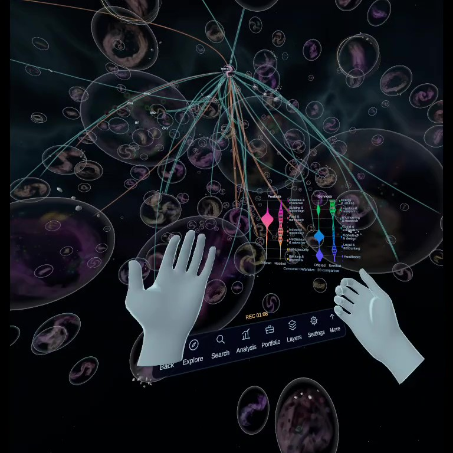
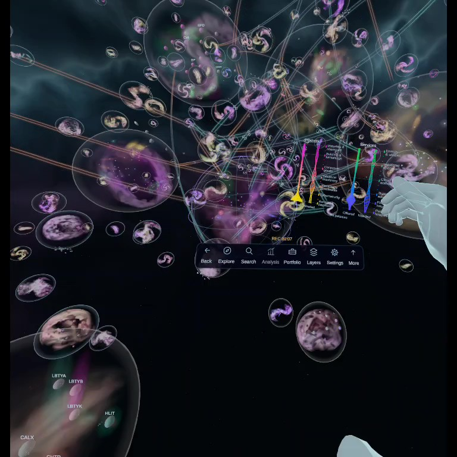
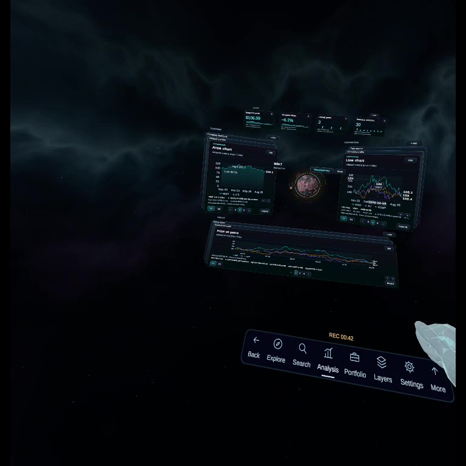
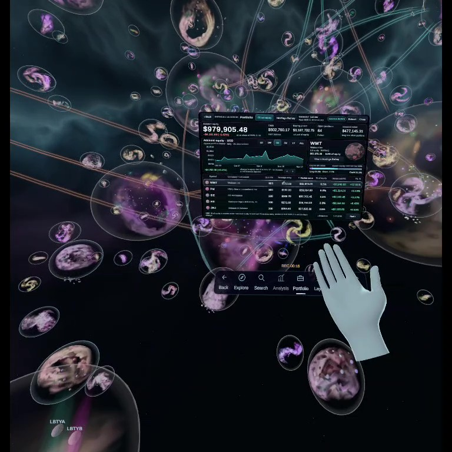

# MarketScout for Meta Quest

**Explore 3,939 public companies as planets in a universe you shape with your hands.** MarketScout is a seated research tool for Meta Quest. It is our entry in the Meta VR Start Developer Competition 2026. The whole app works with hands; controllers are optional.

## Watch the latest walkthrough

**[Play the walkthrough](https://geoscout-ai.github.io/MarketScout-VR/)**, or [download the video](media/walkthrough.mp4). It was recorded inside the headset using hands only, and has no sound.

## Try it in a minute

1. Sit down and put the controllers aside.
2. Open MarketScout. While the universe loads, a guide shows each gesture.
3. When it says "Please clap your hands together", clap once. Then spread your hands to unfold the universe.
4. Look at a galaxy, turn your right palm up and curl your fingers. The ring around the cursor fills as you curl, and the galaxy is selected.
5. Clap and spread your hands to bring that galaxy close.
6. Touch a planet with your fingertip to open that company's dashboards. Sweep your hand to the left over a card to turn it.
7. Turn your left palm up and curl your fingers to go back. Look down to the ribbon for Search, Analysis and Portfolio.

## Hand controls

| Do this | To |
|---|---|
| Clap once | Take hold of the universe, or of the selected galaxy |
| Spread or squeeze both hands | Zoom in or out |
| Swing or roll both hands | Rotate |
| Close a hand, or drop your hands | Let go. The view stays where you left it |
| Look at something, then curl your right palm | Select it |
| Touch a planet with your fingertip | Select that company |
| Curl your left palm | Go back |
| Sweep a hand left over a dashboard | Turn to the next card |
| Tap a ribbon key with your fingertip | Back, Explore, Search, Analysis, Portfolio, Layers, Settings, More |
| Hold the Meta button | Bring the scene back in front of you |

Controllers also work, but nothing in the app needs them.

## What you're looking at

| The universe | Company dashboards | Portfolio |
|---|---|---|
|  |  |  |
| Each bubble is a galaxy of related companies, and each planet in it is one company. Two small plots show what the selected galaxy offers and needs. | Select a planet and its dashboards open around it, with price charts and comparisons with peers. | Reads a paper-trading account (no real money): equity, holdings and history, with each holding linked to its planet. |

## How it's built

- Made in Unity 6 for Meta Quest, using hand tracking.
- The universe is a fixed snapshot of 3,939 companies in 239 galaxies, built into the app.
- Each planet's land, oceans, mountains and trenches come from the company's financial filings with the SEC (10-K and 10-Q).
- The Portfolio reads a live Alpaca paper-trading account over Wi-Fi. It is read-only.
- The workspace sits in front of you, so you never need to stand or turn around.
- The ambient music is original. Visuals use Space Graphics Planets, Shapes and All In 1 VFX from the Unity Asset Store.

This repository holds the walkthrough video and these notes for judges.
